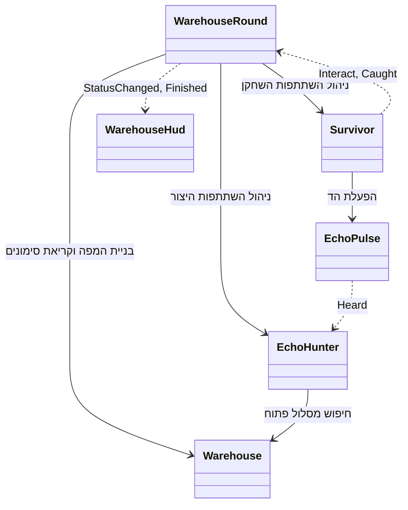

# רעש שמציל | Sound of Survival

אב־טיפוס למטלה 4. במחסן חשוך, גלי קול חושפים את הדרך לזמן קצר ומושכים את היצור לעבר מקור הרעש. כדי לנצח, אספו את הנתיך הצהוב ופתחו את יציאת החירום הסגולה. מגע עם היצור האדום מסיים את הניסיון בהפסד.

[למשחק בדפדפן ב־itch.io](https://kfir-and-evyatar.itch.io/sound-of-survival)

## הרצה ומקשים

פתחו את תיקיית הפרויקט ב־Unity בגרסה 6000.3.27f1. פתחו את הסצנה `Assets/Scenes/Warehouse.unity`, לחצו על **Play** ואז לחצו בתוך חלון **Game**.

- **WASD או מקשי החצים** לתנועה.
- **רווח** שולח הד קצר. **Shift + רווח** שולח הד חזק שחושף שטח גדול יותר ונשמע מרחוק יותר.
- **E** אוסף את הנתיך או פותח את היציאה כשעומדים לידה.
- **Play again** מתחיל ניסיון חדש אחרי ניצחון או הפסד.

## מבנה הקוד

- `EchoPulse` משדר את מיקום ההד ואת טווח השמיעה דרך האירוע `Heard`. בחרנו באירוע כדי שכמה אויבים יוכלו להגיב באופן עצמאי. קריאה ישירה הייתה מקשרת את מנגנון ההד לאויב מסוים.
- `Warehouse` מגדיר את המפה ומחשב את המסלול הקצר ביותר במעברים. תנועה ישירה למקור הקול עלולה לחצות קירות. חישוב המסלול במפה מאפשר ל־`EchoHunter` להתמקד בסיור ובחקירת רעשים.
- `WarehouseHud` מאזין לאירועי הסיבוב ומציג הודעות ותוצאות. קריאה ישירה לממשק מתוך חוקי המשחק הייתה יוצרת תלות באופן ההצגה.

כדי להוסיף סוג אויב, מוסיפים סקריפט ב־`Assets/Scripts/Actors`, מסמנים את מיקומו ב־`Warehouse` ומוסיפים את יצירתו ב־`WarehouseRound`. כדי להוסיף חפץ שנדרש לניצחון, מוסיפים סימון במפה ומעדכנים ב־`WarehouseRound` את כללי האיסוף והניצחון. הממשק מקבל את ההודעות ואת תוצאת המשחק דרך אותם אירועים.

מערך המפה וכיווני המעבר הם שדות `static readonly` כי הם נתוני שלב קבועים המשותפים לכל המופעים. פקודת בניית ה־Web היא נקודת כניסה סטטית לעורך Unity.

## פיזיקה

השחקן משתמש ב־`Rigidbody2D` לתנועה ולהתנגשות בקירות. בעת התנגשות, הקוד קורא את `Collision2D.contactCount` ואת `Collision2D.collider` כדי לזהות מגע עם היצור ולהציג מסך הפסד.

## בניית גרסת דפדפן

התקינו את **Web Build Support** לגרסת Unity של הפרויקט ובחרו **Build → Build Warehouse Web**. כווצו את תוכן התיקייה `Builds/Web` לקובץ ZIP והעלו אותו ל־itch.io כמשחק HTML5 שניתן לשחק בו בדפדפן. הוסיפו בעמוד המשחק את מקשי השליטה וקישור למאגר GitHub.
