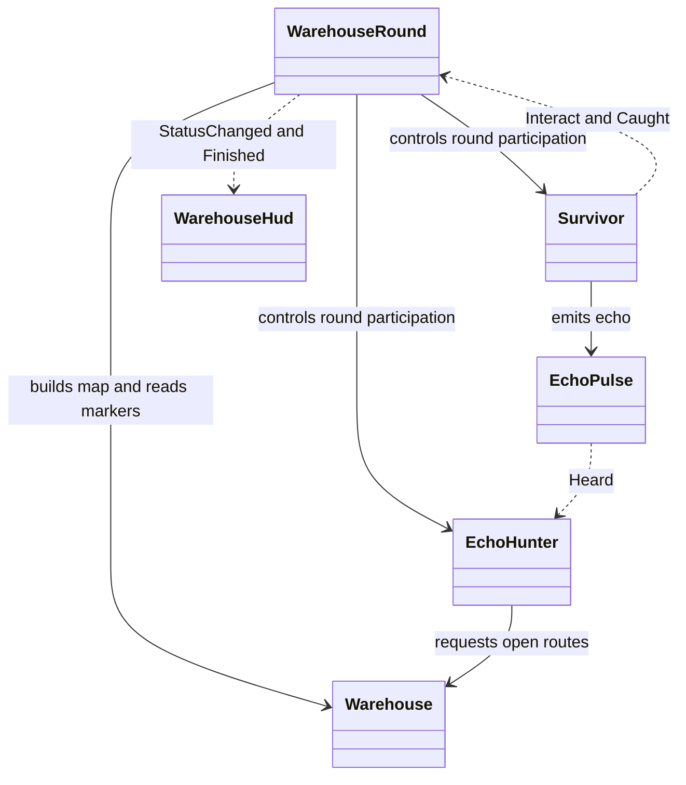

# Sound of Survival | The Dark Warehouse

Assignment 4 prototype. Open this folder in Unity 6000.3.27f1, open
Assets/Scenes/Warehouse.unity and press Play. Focus the Game view.

- WASD or arrows: move.
- Space: short echo. Shift + Space: stronger echo with a greater hearing range.
- E: collect the fuse or open the exit when nearby.
- Find the yellow fuse, then unlock the purple exit. Red is the hunter.
- The hunter patrols and investigates noise. Touching it ends the attempt.
- Use Play again after either result to restart.

## Architecture

- EchoPulse broadcasts the position and hearing range. A direct call to one
  hunter would bind the echo system to that enemy. An event lets multiple
  listeners respond independently.
- Warehouse owns the tile layout and shortest-path search. Moving directly
  toward the sound would cross walls. Keeping routing in the map lets the
  hunter focus on patrol, investigation and search.
- WarehouseHud listens to round events. Calling the HUD directly from game
  rules would make those rules depend on how the game is presented.

To add a hunter variant, add an actor under Assets/Scripts/Actors and give
it a map marker and spawn entry in Warehouse and WarehouseRound. To add a
required item, add a marker in Warehouse and update the interaction and win
rules in WarehouseRound. The HUD still receives status messages and results
through the same events.

There is no gameplay singleton. The map's static readonly layout and
neighbor offsets hold shared level data. The static Web build command is an
editor entry point and holds no runtime state.

The survivor uses Rigidbody2D for wall contact and uses Collision2D.contactCount
and Collision2D.collider to identify physical contact with the hunter.

## Web build

Install Unity Web Build Support for the editor version above. Choose
Build > Build Warehouse Web. Zip the contents of Builds/Web for an HTML5
upload to itch.io. Mark the upload playable in the browser, include the
controls above, and link the GitHub repository. Add the itch.io page link here
after publication.
